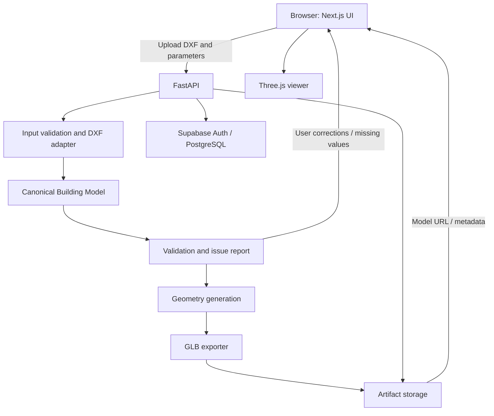

# Technical Architecture

## 1. Architecture goals

- Separate drawing parsing, architectural interpretation, geometry generation and rendering.
- Keep the reconstruction core deterministic and testable without a browser.
- Maintain traceability from 3D elements back to source drawing entities and user-supplied parameters.
- Use open-source libraries and open exchange formats wherever practical.
- Keep the initial architecture simple enough for one developer and a portfolio MVP.
- Preserve a reasonable path to PDF adapters, connected multi-floor projects and large structures.

## 2. High-level system



The diagram shows the logical flow. The first local prototype may run parsing and geometry generation in one Python process. A queue or separate worker should not be introduced until measured processing needs justify it.

## 3. Proposed technology stack

| Area | Initial choice | Why |
|---|---|---|
| Frontend | Next.js, React, TypeScript | Mature web application stack and straightforward Vercel deployment. |
| 3D rendering | Three.js | Browser-native WebGL rendering and camera / scene tools. |
| Backend API | Python + FastAPI | Python ecosystem is suitable for geometry processing; FastAPI gives typed API contracts. |
| DXF parsing | ezdxf | Open-source DXF parsing and entity access. |
| Geometry operations | Shapely + NumPy | Planar geometry, intersections, offsets and numerical operations. |
| 3D representation / export | Prototype with a focused mesh / GLB library, then lock choice after a test | Avoid selecting a library before testing wall meshes, openings and metadata needs. |
| Database and auth | Supabase PostgreSQL + Auth | Managed PostgreSQL and authentication with a free starting tier. |
| File storage | Supabase Storage initially | Persistent object storage; Render's free filesystem must not be treated as durable. |
| Deployment | Vercel frontend, Render API | Matches the intended free-first deployment approach. |
| Version control | Git + GitHub | Source history, issue tracking and portfolio visibility. |

All library versions and plan limits should be checked when implementation starts; this document intentionally avoids pinning versions before the repository is created.

## 4. Core processing pipeline

### Stage 1: Intake

1. Receive upload and a project / floor identifier.
2. Validate extension, file signature/readability and configured size limit.
3. Create a temporary working copy.
4. Parse drawing header / units and enumerate layers, blocks and entities.
5. Reject invalid files safely.

### Stage 2: DXF adapter

The adapter translates supported DXF entities into an internal normalized representation. It should not directly create Three.js objects or mix web concerns into the parser.

The first supported convention should be selected after inspecting sample files. Possible entities to investigate include lines, polylines, arcs, circles, inserts/blocks, text and dimension objects. The MVP should explicitly state which are supported and under what conditions.

### Stage 3: Canonical building representation

The canonical model is the boundary between file-specific adapters and geometry generation. It should include:

- project identity;
- building identity;
- floor identity and elevation;
- normalized units and coordinate system;
- walls, floor boundaries, openings and supported structural elements;
- geometry in well-defined units;
- source entity references;
- provenance for dimensions and other important values;
- validation issues and confidence / uncertainty metadata where appropriate.

A simplified conceptual element shape:

```json
{
  "id": "wall-001",
  "type": "wall",
  "geometry": { "kind": "line", "start": [0, 0], "end": [4000, 0] },
  "height": { "value": 3000, "unit": "mm", "source": "user_provided" },
  "thickness": { "value": 150, "unit": "mm", "source": "source_extracted" },
  "source": { "format": "dxf", "layer": "A-WALL", "entity_handle": "2AF" },
  "status": "verified"
}
```

This is an illustrative shape, not a final schema. Units, coordinate conventions, geometry variants and provenance types must be formalised before the geometry engine depends on them.

### Stage 4: Validation

Validation should check such things as:

- missing required units / scale / heights;
- unsupported entities or ambiguous symbols;
- duplicate or degenerate geometry;
- invalid or self-intersecting boundaries;
- inconsistent dimensions;
- gaps / overlaps that break supported room or wall construction; and
- limits for file size, drawing extent and processing complexity.

Separate blocking errors from non-blocking warnings. Preserve validation output in the project report.

### Stage 5: Geometry generation

Convert canonical 2D elements into 3D meshes using explicit rules:

- wall path / footprint + thickness + height → wall volume;
- floor boundary + thickness / elevation → floor mesh;
- opening information → aperture or opening geometry;
- supported column footprint + height → column mesh.

The geometry engine should keep units explicit and should not infer unknown height values without recording the assumption. Handle wall junctions and openings through testable geometry functions rather than a large monolithic routine.

### Stage 6: Export and viewer

Export a GLB model and an accompanying metadata / verification representation. The browser viewer loads the GLB, then uses stable element IDs or a linked metadata structure to show measurements and provenance when objects are selected.

Do not assume that all semantic metadata will survive arbitrary export tooling. Prototype and test metadata round-tripping early.

## 5. API boundary

Initial endpoints may include:

| Method | Path | Purpose |
|---|---|---|
| `POST` | `/api/v1/projects` | Create project metadata (when persistence is introduced). |
| `POST` | `/api/v1/floors/{floor_id}/uploads` | Upload and preflight a DXF. |
| `GET` | `/api/v1/jobs/{job_id}` | Read processing state / result summary. |
| `GET` | `/api/v1/jobs/{job_id}/interpretation` | Retrieve canonical interpretation and issues. |
| `POST` | `/api/v1/jobs/{job_id}/corrections` | Submit user corrections / required parameters. |
| `POST` | `/api/v1/jobs/{job_id}/generate` | Start geometry generation. |
| `GET` | `/api/v1/models/{model_id}` | Retrieve model metadata and artifact location. |

These are candidate contracts, not a requirement to implement all endpoints in the first coding session. A local synchronous pipeline may initially use fewer endpoints.

## 6. Data and persistence

- PostgreSQL stores users' project metadata, job metadata and model / verification metadata.
- Object storage stores original uploads, generated GLB files and optional reports.
- Temporary parsing files are deleted after processing or according to a documented retention policy.
- Never store permanent files on Render's ephemeral service filesystem.
- Keep the canonical model serialisable as JSON so it can be tested, inspected and versioned independently of the renderer.

## 7. Local-first development path

Before connecting hosted services:

1. build the DXF parser as a Python module;
2. save canonical JSON output to disk;
3. generate a test mesh / GLB locally;
4. load the GLB in a small Three.js viewer;
5. wrap the stable pipeline with FastAPI;
6. connect the Next.js frontend;
7. add Supabase persistence and deployment after the local slice is repeatable.

This order reduces the number of simultaneous failure sources.

## 8. Error handling and security

- Treat uploaded drawings as untrusted input.
- Validate file type, size, parsing time and resource limits.
- Do not execute content from uploaded files.
- Use generated server-side filenames; do not trust supplied paths.
- Clean temporary files.
- Authenticate project access and enforce user-level ownership before retrieval.
- Use environment variables for credentials and keep `.env` out of Git.
- Return actionable error codes and safe user-facing messages; keep detailed diagnostics in logs.

## 9. Large and complicated structures: future architecture path

The current schema should use project → building → floor → element hierarchy. Later, large facilities may require:

- multiple independent floor jobs;
- global coordinate systems and consistent floor elevations;
- zones / wings / buildings within one site;
- spatial chunks or tiles;
- incremental regeneration when one zone changes;
- level-of-detail generation and lazy loading in the viewer;
- asynchronous job queues and dedicated workers;
- progress reporting and cancellation; and
- storage / compute selected from benchmark results.

Do not implement those mechanisms in the MVP unless a benchmark demonstrates an immediate need. Avoid arbitrary schema choices that make these future capabilities impossible, but do not build a distributed platform prematurely.

## 10. Architecture decisions to record

Use an Architecture Decision Record (ADR) whenever a decision changes a core boundary, such as coordinate system, canonical schema, wall representation, geometry library, export format or job execution model. Each ADR should state context, decision, alternatives, consequences and date.
